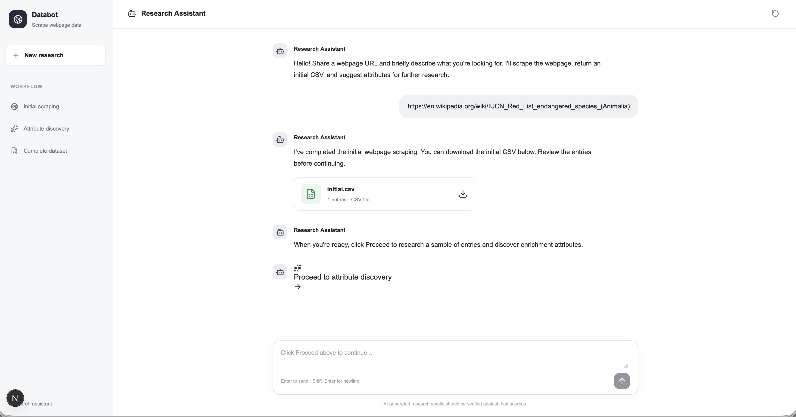

# databot

Databot allows you to scrape HTML websites around a topic fully and iteratively based on an initial website, allowing the user to control what content to select. 

# features

- Flat HTML website scraping     
- Card item scraping (todo)     

This is still under developments and much features don't work.     

# progress

- backend framework ✓       
- frontend mockup ✓      
- backend/frontend connection ✓
- AI to back up backend API endpoints 📌    

# backend

- init_search(): takes a webpages and scrape suggested elements.  
- save_init_search(): take the elements and save as a csv
- discover_attributes(): take randomly sampled 10 entries, google search top n webpages and extract most relevant attributes of the entries.        
- summarize_attributes(): take 10 entries, a set of attributes, search the web and summarize each attributes.      
- expand_searching_attr(): take randomly 10 entries from csv, google search and summarize attributes scraped.     

wrap these utility functions into these routes:     
- /init_search: applies init_search() and then save_init_search(), returns the initial csv     
- /expand_search: take the initial csv, apply expand_searching_attr(), return the searched attributes for 10 entries randomly chosen.     
- /search: take n requested attributes, all included in the searched attributes from the second route, conduct google search summarization for each of the entries in the initial csv.     